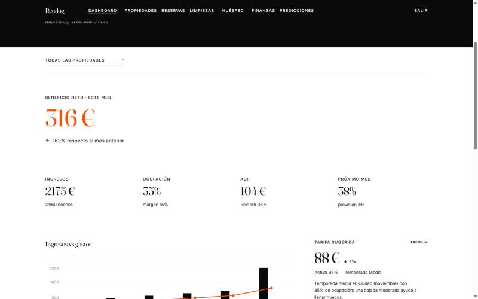
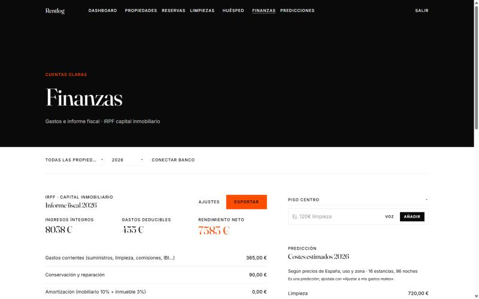
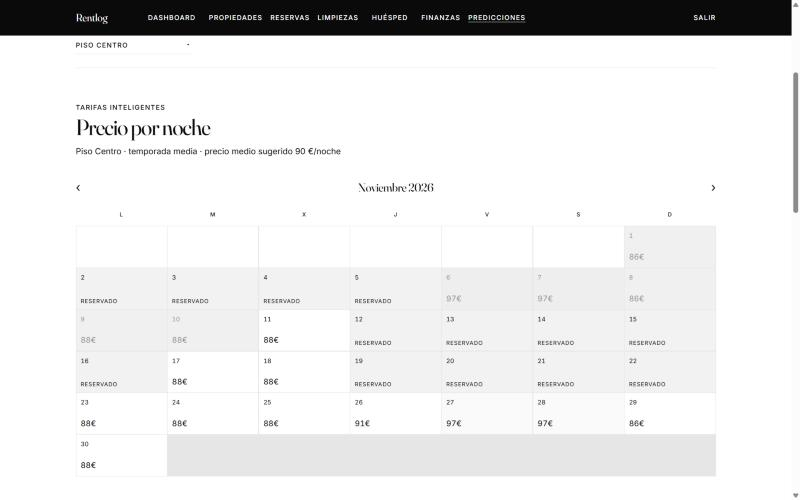
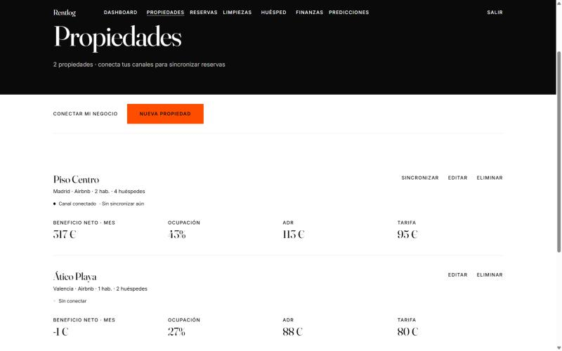

<div align="center">

# Rentlog

**Analítica y gestión para anfitriones de alquiler turístico.**
Ingresos, gastos, KPIs hoteleros y beneficio neto real por propiedad, con la
seguridad en la base de datos y no en el front.

[**Demo en vivo →**](https://rentlog-two.vercel.app)


🇬🇧 [English version](README.md)

</div>

---

<div align="center">
  
  <em>Dashboard — beneficio neto del mes, KPIs hoteleros y la tarifa sugerida.</em>
</div>

<table>
<tr>
<td width="50%"><br><sub><b>Finanzas</b> — gastos deducibles e informe de IRPF.</sub></td>
<td width="50%"><br><sub><b>Smart Rate</b> — precio sugerido por noche frente a la ocupación real.</sub></td>
</tr>
<tr>
<td width="50%"><br><sub><b>Propiedades</b> — beneficio neto, ocupación y ADR por piso.</sub></td>
<td width="50%" valign="top"><br><sub>Capturas en <b>modo demo</b>, que es lo que sale al clonar y ejecutar <code>npm run dev</code> sin configurar nada. Los datos son de ejemplo.</sub></td>
</tr>
</table>

## Qué hace

Un anfitrión con uno o cinco pisos lleva las cuentas en una hoja de cálculo y
pone los precios a ojo. Rentlog convierte las dos cosas en algo medible:

- **KPIs hoteleros por propiedad y por mes**: ocupación, ADR, RevPAR y la
  ocupación de equilibrio necesaria para cubrir los costes fijos.
- **Beneficio neto real**, ingresos menos gastos, prorrateando las reservas que
  cruzan de mes en vez de asignarlas a uno solo.
- **Gastos por voz o en lenguaje natural**: el motor financiero de
  [Gastolens](https://github.com/JaimeMoralesCastro/Gastolens) se reutiliza aquí
  como módulo nativo. Dices *"limpieza 45 euros"* y el gasto se apunta solo.
- **Smart Rate** con recomendaciones de precio, calendario de ocupación,
  planificación de limpiezas, hub del huésped y guía, e informe fiscal español.
- **Importación** desde iCal (Airbnb/Booking), extractos del banco y,
  opcionalmente, un buzón de Gmail conectado para correos de reservas y pagos.

Arranca en **modo demo sin configurar nada**: clonas, `npm run dev`, y tienes
dos propiedades con un año de datos de ejemplo. Sin proyecto de Supabase, sin
claves y sin registro.

## Cómo se protegen los datos

Lo interesante de este proyecto no es el panel, es el esquema.

Todas las tablas tienen **Row Level Security** activado con una política
`auth.uid() = user_id`, así que un anfitrión no puede leer la reserva de otro
ni manipulando el cliente. El front no contiene lógica de autorización: si se
sustituyera por completo, los datos seguirían cerrados.

Los KPIs mensuales se calculan en una **vista** de Postgres
(`monthly_property_kpis`) en vez de en JavaScript, para que las definiciones
vivan en un único sitio:

```
ocupación  = noches vendidas / noches disponibles
ADR        = ingresos / noches vendidas
RevPAR     = ingresos / noches disponibles
equilibrio = ocupación mínima para cubrir costes fijos
```

Tablas: `properties`, `reservations`, `expenses`, `reviews`, `market_data`.

## Arrancar en local

```bash
npm install
npm run dev        # http://localhost:5174 — arranca en modo demo
```

### Conectar un proyecto real de Supabase

1. Crea un proyecto en [supabase.com](https://supabase.com).
2. En el *SQL Editor*, ejecuta [`supabase/schema.sql`](supabase/schema.sql):
   crea las tablas, las políticas RLS y la vista de KPIs. Los ficheros
   `schema-*.sql` añaden los módulos opcionales (limpieza, conector bancario,
   Gmail).
3. Copia `.env.example` a `.env` y rellena `VITE_SUPABASE_URL` y
   `VITE_SUPABASE_ANON_KEY`.
4. `npm run dev`, ahora con autenticación real y datos persistentes.

Guía completa en [`docs/deployment.md`](docs/deployment.md).

## Estructura

```
src/
├── finance/        motor financiero compartido con Gastolens
│   ├── nlpParser.js       parser de gastos en lenguaje natural
│   ├── metrics.js         KPIs hoteleros (ocupación, ADR, RevPAR, P&L)
│   ├── fiscalSpain.js     informe fiscal español
│   ├── forecast.js        proyección de demanda e ingresos
│   ├── icalParser.js      importación de calendarios Airbnb/Booking
│   └── emailParser.js     correos de reservas y pagos
├── banking/        proveedores de extractos bancarios y mapeo
├── connector/      conector de canales (iCal / API)
├── email/          conexión con Gmail e importación del buzón
├── components/     dashboard, tarjetas de KPI, gráficas, calendario, Smart Rate
├── contexts/       AuthContext (Supabase + modo demo)
└── lib/            cliente de Supabase, datos demo, almacenes locales
supabase/
├── schema.sql      tablas, políticas RLS, vista monthly_property_kpis
├── schema-*.sql    módulos opcionales
└── functions/      Edge Functions (sync iCal, Gmail, datos de mercado, Stripe)
scripts/            siembra de datos demo y pruebas del parser
docs/               despliegue, diseño, estudio de mercado, planes de integración
```

## Estado

La fase 1 (MVP) está desplegada: dashboard, KPIs, gastos por voz y calendario de
ocupación. La fase 2 —multi-propiedad avanzada, predicción de demanda, Smart
Rate v2 e informe fiscal— está parcialmente hecha. La fase 3 es la integración
de canales y la automatización; ver
[`docs/channel-integration-plan.es.md`](docs/channel-integration-plan.es.md).

## Por qué este proyecto

Debajo del panel esto es un pequeño sistema de revenue management. Ocupación,
ADR y RevPAR son el vocabulario con el que decide un hotel, y la ocupación de
equilibrio convierte un coste fijo en el único número que dice si el mes sale.
Smart Rate cierra el círculo: no informa del pasado, propone un precio para una
noche concreta.

Eso es lo que me interesa de construirlo: no las gráficas, sino la **regla de
operación de debajo** —con esta demanda, estos costes y este calendario, qué
debería hacer el anfitrión esta noche—. Es la misma forma de problema que fijar
un nivel de servicio o un punto de pedido, que es hacia donde quiero llevar
esto: **logística empresarial e industrial**, operaciones y planificación.

## Licencia

[MIT](LICENSE) © Jaime Morales Castro
