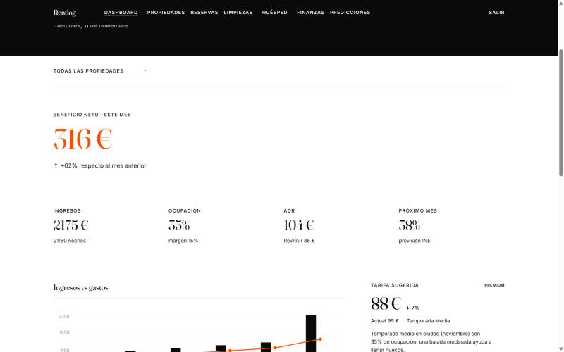
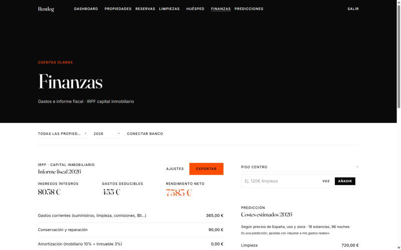
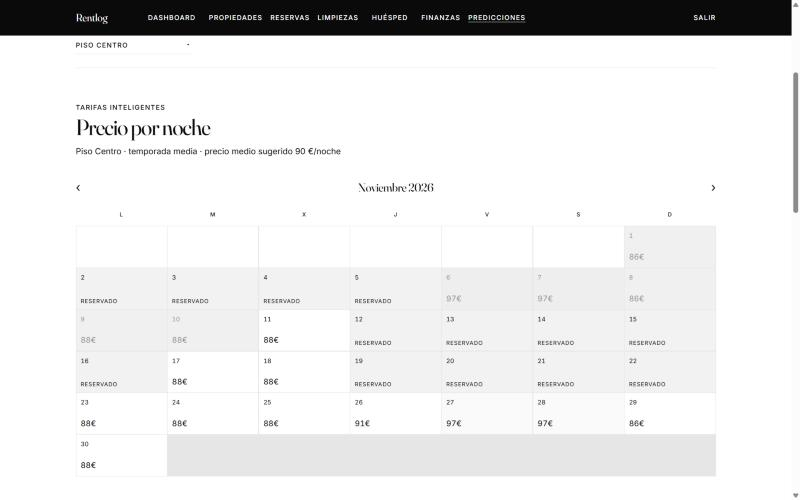
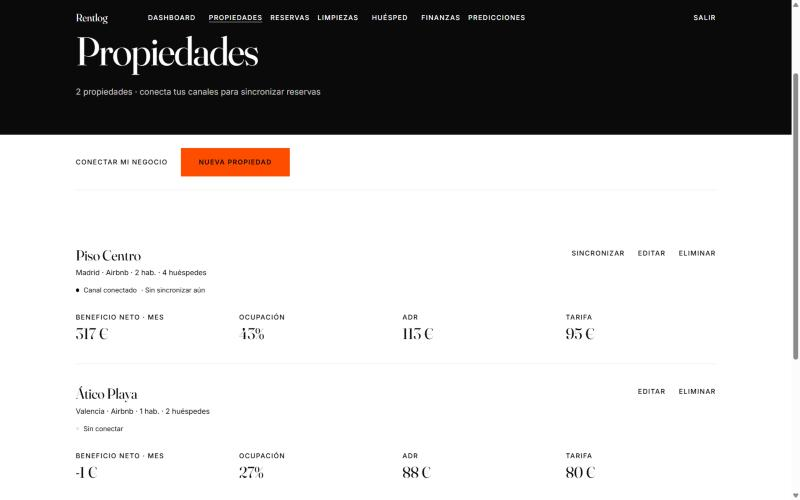

<div align="center">

# Rentlog

**Analytics and bookkeeping for short-term rental hosts.**
Revenue, expenses, hotel KPIs and real net profit per property — with security
enforced in the database, not in the front end.

[**Live demo →**](https://rentlog-two.vercel.app)


🇪🇸 [Versión en español](README.es.md)

</div>

---

<div align="center">
  
  <em>Dashboard — net profit for the month, hotel KPIs and the Smart Rate suggestion.</em>
</div>

<table>
<tr>
<td width="50%"><br><sub><b>Finances</b> — deductible expenses and the Spanish IRPF report.</sub></td>
<td width="50%"><br><sub><b>Smart Rate</b> — suggested price per night against real occupancy.</sub></td>
</tr>
<tr>
<td width="50%"><br><sub><b>Properties</b> — net profit, occupancy and ADR per flat.</sub></td>
<td width="50%" valign="top"><br><sub>Screenshots taken in <b>demo mode</b>, the state you get by cloning and running <code>npm run dev</code> without any configuration. The data is sample data.</sub></td>
</tr>
</table>

## What it does

Hosts running one to five flats usually track money in a spreadsheet and guess
at their pricing. Rentlog turns both into something measurable:

- **Hotel KPIs per property and per month** — occupancy, ADR, RevPAR and the
  break-even occupancy needed to cover fixed costs.
- **Real net profit**, revenue minus expenses, prorating reservations that cross
  a month boundary instead of assigning them to one.
- **Expenses by voice or plain language** — the finance engine from
  [Gastolens](https://github.com/JaimeMoralesCastro/Gastolens) is reused here as
  a native module: say *"cleaning 45 euros"* and it files itself.
- **Smart Rate** price suggestions, occupancy calendar, cleaning schedule,
  guest hub and guidebook, and a Spanish tax-report view.
- **Imports** from iCal (Airbnb/Booking), bank statements and, optionally, a
  connected Gmail inbox for reservation and payout emails.

It runs in **demo mode out of the box**: clone, `npm run dev`, and you get two
properties with a full year of sample data — no Supabase project, no keys, no
sign-up.

## How the data is protected

The interesting part of this project is not the dashboard, it is the schema.

Every table has **Row Level Security** enabled with an `auth.uid() = user_id`
policy, so one host cannot read another host's reservation even by tampering
with the client. The front end holds no authorisation logic at all; if it were
replaced wholesale, the data would stay closed.

Monthly KPIs are computed in a Postgres **view** (`monthly_property_kpis`)
rather than in JavaScript, which keeps the definitions single-sourced:

```
occupancy  = nights sold / nights available
ADR        = revenue / nights sold
RevPAR     = revenue / nights available
break-even = minimum occupancy to cover fixed costs
```

Tables: `properties`, `reservations`, `expenses`, `reviews`, `market_data`.

## Running it locally

```bash
npm install
npm run dev        # http://localhost:5174 — starts in demo mode
```

### Connecting a real Supabase project

1. Create a project at [supabase.com](https://supabase.com).
2. In the SQL editor, run [`supabase/schema.sql`](supabase/schema.sql) — it
   creates the tables, the RLS policies and the KPI view. The `schema-*.sql`
   files add the optional modules (cleaning, bank connector, Gmail).
3. Copy `.env.example` to `.env` and fill in `VITE_SUPABASE_URL` and
   `VITE_SUPABASE_ANON_KEY`.
4. `npm run dev` — now with real authentication and persistent data.

Full walkthrough in [`docs/deployment.md`](docs/deployment.md) (Spanish).

## Layout

```
src/
├── finance/        finance engine shared with Gastolens
│   ├── nlpParser.js       natural-language expense parser
│   ├── metrics.js         hotel KPIs (occupancy, ADR, RevPAR, P&L)
│   ├── fiscalSpain.js     Spanish tax report
│   ├── forecast.js        demand and revenue projection
│   ├── icalParser.js      Airbnb/Booking calendar import
│   └── emailParser.js     reservation and payout emails
├── banking/        bank statement providers and mapping
├── connector/      channel connector (iCal / API)
├── email/          Gmail connection and inbox import
├── components/     dashboard, KPI cards, charts, calendar, Smart Rate
├── contexts/       AuthContext (Supabase + demo mode)
└── lib/            Supabase client, demo data, local stores
supabase/
├── schema.sql      tables, RLS policies, monthly_property_kpis view
├── schema-*.sql    optional modules
└── functions/      Edge Functions (iCal sync, Gmail, market data, Stripe)
scripts/            demo seeding and parser test scripts
docs/               deployment, design, market research, integration plans
```

## Status

Phase 1 (MVP) is live: dashboard, KPIs, voice expenses, occupancy calendar.
Phase 2 — advanced multi-property, demand forecasting, Smart Rate v2 and the
tax report — is partially in place. Phase 3 is channel integration and
automation; see [`docs/channel-integration-plan.es.md`](docs/channel-integration-plan.es.md).

## Why this project

Behind the dashboard this is a small revenue-management system. Occupancy, ADR
and RevPAR are the vocabulary hotels use to decide, and break-even occupancy
turns a fixed cost into the one number that says whether a month works. Smart
Rate closes the loop: it does not report the past, it proposes a price for a
specific night.

That is what interests me about building it — not the charts, but the
**operating rule underneath**: given this demand, this cost base and this
calendar, what should the host actually do tonight. The same shape of problem
as setting a service level or a reorder point, which is the direction I want
to take this: **business and industrial logistics**, operations and planning.

## License

[MIT](LICENSE) © Jaime Morales Castro
